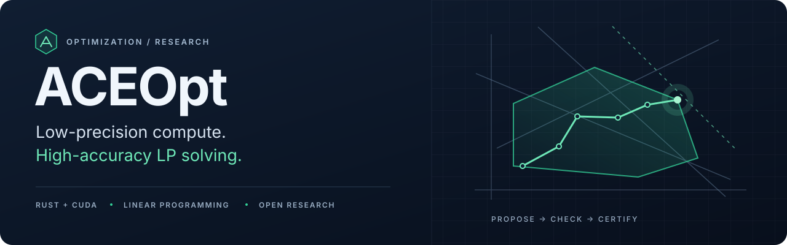

<p align="center">
  
</p>

<p align="center">
  <a href="LICENSE"></a>
  <a href="rust-toolchain.toml"></a>
  <a href="docs/operations/build.md"></a>
  <a href="wiki/status.md"></a>
</p>

<p align="center">
  <a href="#quick-start">Quick start</a> ·
  <a href="docs/benchmarks/lp-sp-pricing-comprehensive.md">Benchmarks</a> ·
  <a href="#project-navigation">Documentation</a> ·
  <a href="docs/plans/gpu-lp-precision-roadmap.md">Roadmap</a> ·
  <a href="CONTRIBUTING.md">Contributing</a>
</p>

**ACEOpt is a research project focused on accelerating high-accuracy linear
programming (LP) with the low-precision floating-point capabilities of modern
NVIDIA GPUs.** Fast numerical computation is paired with independent checks
against the original model.

Our long-term goal is to build fast, reliable solvers that make full use of
modern computing hardware. Built in Rust with CUDA backends, ACEOpt combines
an optimization CLI with isolated research solvers.

Our latest research implements key ideas from OpenAI's
[Strongly Polynomial Linear Programming](https://github.com/openai/math/blob/main/preprints/Strongly-polynomial-linear-programming-November-24-2026/paper.pdf),
with practical CPU/GPU engineering. On several tested synthetic LP families,
it achieves lower complete certified-solve times than COPT, including preparation
and independent proof. This implementation uses **FP64 proposals**; its reported
gains come from algorithmic and CPU/GPU engineering and do not measure FP4
acceleration. Our low-precision work is documented in separate
[precision studies](docs/plans/gpu-lp-precision-roadmap.md).

## Why ACEOpt?

- **Low-precision compute, high-accuracy goals.** Explore FP32 and FP4 GPU
  computation for faster LP solving, while retaining independent original-model
  checks as the acceptance authority.
- **Separate computation from trust.** Numerical methods propose solutions;
  independent checks assess them against the original model. The pricing research
  path uses exact feasibility and zero-gap certificates.
- **Measure the whole solve.** Published comparisons include model preparation,
  solving, endpoint construction, and independent certification.
- **Keep results inspectable.** Versioned records capture configurations and
  provenance. Reports retain deadlines, failed attempts, and slower cases.
- **Build on clear interfaces.** A Rust workspace separates models, solver
  backends, search, extensions, and GPU ownership.

## Quick start

**Platform:** Linux x86-64. Install Rust through rustup (the repository pins
1.93.1), Python 3.11+, Git, util-linux `flock`, CMake, and a C++17 compiler.
Native research CPU tests also require the GMP 6 runtime (`libgmp.so.10`).
The standard CPU build does not require a GPU or CUDA toolkit.

```bash
git clone https://github.com/liuyumou/OptForge.git
cd OptForge

python3 -m venv .venv
. .venv/bin/activate
python3 -m pip install -r tools/requirements.txt

# Build the pinned HiGHS 1.11.0 CPU backend and the Rust workspace.
bash tools/setup_highs.sh
cargo build --workspace --locked

# Solve the included model.
cargo run -p optimizer-cli -- solve \
  --model examples/model-v1.json \
  --config examples/solve-config-v1.json
```

The example minimizes `2 x3 + x8 + 0.5` subject to `x3 + x8 >= 2`, with
`x3` binary and `x8` continuous and nonnegative. The returned JSON record includes
`"termination": "optimal"` and `"objective": 2.5`, with the objective and candidate
feasibility recomputed by the core.

This quick start uses HiGHS and its recorded numerical tolerances. The exact
certified pricing solver behind the benchmark results is a separate
[research package](research/lp-sp-pricing/README.md), not a default CLI backend.

Continue with [model validation](docs/tutorials/model-validation.md),
[solving and result fields](docs/tutorials/solve-a-model.md), or
[running and verifying a search](docs/tutorials/run-and-verify.md).
For contributor checks, see [build and verification](docs/operations/build.md).

## Certified LP benchmarks

Results below are for synthetic dyadic LPs on an **Intel Xeon Platinum 8457C +
NVIDIA RTX PRO 6000 Blackwell Server Edition**, with **COPT 8.0.6** and four CPU
slots. Each cell shows **median complete seconds (timely certified runs / 3
attempts)**. Lower is better; a dash means no timely certified result.

| Family | Nonzeros | ACEOpt | COPT GPU | COPT CPU auto |
| --- | ---: | ---: | ---: | ---: |
| Dense-wide | 1M | 1.527 (3/3) | 2.469 (3/3) | — (0/3) |
| Dense-wide | 4M | 3.281 (3/3) | 4.782 (3/3) | — (0/3) |
| Sparse-wide | 1M | 3.268 (3/3) | 3.819 (3/3) | — (0/3) |
| Mixed-square | 1M | 1.875 (3/3) | 2.786 (3/3) | 5.229 (3/3) |
| Dense-square | 4M | 5.186 (3/3) | 63.701 (1/3) | 35.161 (3/3) |
| Banded-square | 4M | 8.691 (3/3) | — (0/3) | — (0/3) |
| Irregular-square | 1M | 6.480 (3/3) | 16.250 (2/3) | — (0/3) |
| Scaled-square | 1M | 2.727 (3/3) | 23.552 (1/3) | — (0/3) |
| Mixed-rectangular | 1.5M | 2.493 (3/3) | 2.802 (3/3) | 13.659 (3/3) |
| Mixed-tall | 1M | 2.216 (3/3) | 2.369 (3/3) | 52.094 (1/3) |
| Mixed-tall | 4M | 3.742 (3/3) | 4.438 (3/3) | — (0/3) |
| Mixed-tall | 16M | 11.579 (3/3) | 14.765 (3/3) | — (0/3) |
| Mixed-scaled-tall | 1M | 2.770 (3/3) | 2.431 (3/3) | — (0/3) |
| Mixed-scaled-tall | 4M | 5.408 (3/3) | 4.446 (3/3) | — (0/3) |

COPT GPU uses PDLP with presolve and crossover disabled; COPT CPU uses its
automatic method. Medians cover each lane's timely certified runs, so different
success counts do not establish matched speedups. Scaled-tall rows are from the
fresh evaluation; the other rows retain their documented cohorts. COPT GPU is
faster on both scaled-tall cases.

These experiments do not establish general superiority, a completed literal
strongly polynomial solver, or low-precision end-to-end gains. See the
[full implementation and performance report](docs/benchmarks/lp-sp-pricing-comprehensive.md)
for settings, proofs, individual timings, and limits, or inspect the
[comparison CSV](docs/benchmarks/lp-sp-pricing-pipeline-comparison.csv).

## From proposal to proof

The pricing research pipeline keeps numerical work and mathematical acceptance
separate:

1. **Prepare** the original model and select a path for its shape.
2. **Propose** a solution with CPU factorization or eligible resident FP64 GPU
   projection.
3. **Recover** an exact primal/dual representation where supported.
4. **Certify** feasibility and zero gap independently on the original model.

Low-precision and billion-nonzero studies have their own configurations, checks,
and recorded outcomes. Start with the [precision roadmap](docs/plans/gpu-lp-precision-roadmap.md)
and [billion-nonzero study](docs/benchmarks/lp-billion.md) for that evidence.
The public host/GPU LP backends use the separately documented
[certification arithmetic and limits](docs/architecture/lp-certification.md).

## Project navigation

| I want to… | Start here |
| --- | --- |
| Run my first model | [Validate a model](docs/tutorials/model-validation.md) · [Solve a model](docs/tutorials/solve-a-model.md) |
| Reproduce a search | [Run and verify](docs/tutorials/run-and-verify.md) · [First experiment](docs/tutorials/first-experiment.md) |
| Understand the results | [Certified LP report](docs/benchmarks/lp-sp-pricing-comprehensive.md) · [Benchmark policy](docs/benchmarks/protocol.md) |
| Explore the implementation | [Architecture](docs/architecture/overview.md) · [Backend contract](docs/specifications/SPEC-0002-backend-contract.md) · [Research package](research/lp-sp-pricing/README.md) |
| Work with a GPU | [GPU operations and leases](docs/operations/gpu.md) · [GPU LP backend](docs/specifications/SPEC-0011-gpu-lp-backend.md) |
| Extend or contribute | [Contributing](CONTRIBUTING.md) · [Build and verification](docs/operations/build.md) · [Register an extension](docs/tutorials/register-an-extension.md) |
| See what's next | [Status](wiki/status.md) · [Precision roadmap](docs/plans/gpu-lp-precision-roadmap.md) · [Backlog](state/backlog.yaml) · [Changelog](CHANGELOG.md) |

The [wiki](wiki/README.md) provides navigation; `docs/` holds the authoritative
contracts and evidence. The [implementation plan](implementation-plan.md) and
[research plan](ai-native-optimizer-plan.md) describe longer-term goals, including
unvalidated research hypotheses.

## Layout

| Path | What lives here |
| --- | --- |
| [`crates/`](crates/) | Rust models, solver backends, search executive, CLI, extensions, and run records |
| [`cuda/`](cuda/) | GPU kernels and device-side computation |
| [`research/`](research/) | Isolated experimental solvers and precision studies |
| [`examples/`](examples/) · [`schemas/`](schemas/) | Example models, configurations, and versioned JSON contracts |
| [`tests/`](tests/) · [`tools/`](tools/) | Contract checks, build tools, and validation tooling |
| [`docs/`](docs/) · [`wiki/`](wiki/) | Specifications, tutorials, operations, benchmark evidence, and navigation |

Python is currently repository tooling; a Python SDK is planned. Dynamically
loaded native extensions and persistent checkpoint restart also remain planned.
See [known limitations](state/known-failures.md).

## Contributing

Contributions to solver engineering, independent validation, reproducible
benchmarks, and documentation are welcome. Start with the
[contribution guide](CONTRIBUTING.md) and [backlog](state/backlog.yaml).
Use [GitHub issues](https://github.com/liuyumou/OptForge/issues) for bugs and
feature proposals, including the configuration and reproduction steps when
reporting a numerical issue.

## License

Project code and small generated fixtures are [MIT licensed](LICENSE).
HiGHS 1.11.0 is also MIT licensed and is built from pinned, checksum-verified
upstream source. Other external datasets and native dependencies require their
own license records; no third-party benchmark dataset is bundled.
