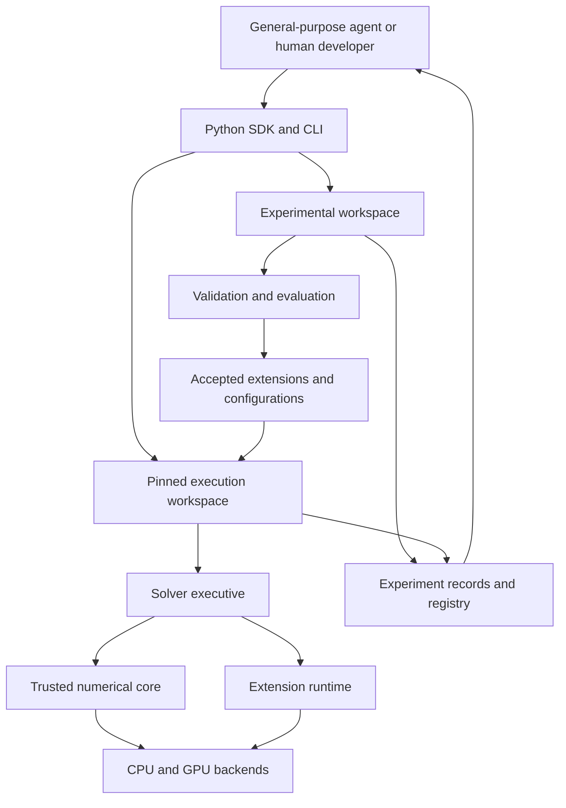

# AI-Native Optimizer: Architecture and Research Plan

Date: **8 September 2026**.

Status: **Consolidated project direction and implementation roadmap.** This document records the proposed design; it does not claim that the engine, benchmarks, or performance results already exist. Working defaults and unresolved decisions are identified explicitly.

Background: [Mathematical optimization solvers and benchmarks](optimizer-survey.md) and [LLMs and agents for operations research](llm-or-survey.md). These surveys provide context, not limits on the design space.

## 1. Vision

Build a new, extensible mathematical optimization engine with a high-performance Rust core, selective GPU acceleration, and reusable official and third-party algorithm extensions. General-purpose agents should be able to inspect, configure, experiment with, and improve the engine through ordinary programming tools.

The long-term ambition is a solver in the broad category of Gurobi or COPT. The first-year objective is a credible research engine demonstrating a repeatable advantage on a defined workload, supported by reproducible experiments and explicit correctness guarantees. General-purpose commercial competitiveness is a longer-term objective, not a first-year promise.

The central opportunity is **learning how to match algorithms and computational resources to problem structure**. Rust, GPUs, and extensibility support this objective. Individually, they are not sufficient evidence of novelty or superior performance.

### Agreed Direction

- Develop an owned solver architecture and execution model, while reusing numerical components where useful.
- Make extensions first-class and support their eventual distribution through a hub.
- Let general-purpose agents select configurations, conduct experiments, and develop reusable algorithms.
- Invest domain expertise in numerical implementation, interfaces, verification, and experimental evidence.
- Avoid dependence on a bespoke domain-specific agent harness or fixed multi-agent reasoning workflow.
- Use implementation experience to identify research problems, then investigate them through explicit hypotheses and controlled experiments.

### Working Defaults

- A 6-8-person research team and a 12-month initial program.
- LP/MILP as the first implemented problem classes; production scheduling as the initial application family.
- Rust for the engine and host interfaces, with foreign numerical libraries and CUDA kernels where justified.
- An established CPU LP backend initially, with GPU LP work evaluated as a complementary component.
- A local extension registry before a public hub.
- A Python SDK and CLI as the primary agent and developer interfaces; MCP is an optional adapter.

These defaults make the project concrete without committing to rebuilding every numerical algorithm immediately.

## 2. What AI-Native Means

AI-native means the architecture can benefit from stronger general agents, more computational experiments, and accumulated execution experience. It does not require a language model inside every solver operation.

| Timescale | Decisions | Initial mechanism |
|---|---|---|
| Development | Discover algorithms, implement extensions, investigate failures, design experiments. | General coding/research agents operating in an experimental workspace. |
| Before a solve | Inspect structure, retrieve relevant experience, select compatible extensions and settings. | General agents, conventional selectors, and optional learned performance models. |
| During a solve | Schedule heuristics, select search actions, allocate effort, react to progress. | Low-overhead rules and interchangeable learned policies. |
| Across solves | Improve reusable algorithms and selection policies from validated experience. | Offline analysis, training, and controlled promotion of new artifacts. |

The deployed engine must also work without an agent, using a pinned configuration and installed extensions. Agent access is a way to develop and operate the system, not a prerequisite for numerical execution.

### Relationship to the Bitter Lesson

General agents may absorb capabilities currently implemented through specialized prompts, expert roles, and hand-designed reasoning sequences. The architecture should benefit from that progress rather than duplicate it.

The durable project assets are a capable optimization environment, efficient execution, reliable feedback, and validated experience. Domain-specific numerical algorithms and mathematical contracts remain necessary. The bitter lesson motivates general learning and scalable experimentation; it does not imply that every domain-specific component will disappear.

**Architectural test:** a stronger general agent should use the same interfaces more effectively without requiring a redesigned harness.

## 3. System Architecture



### Solver Executive

Own the search state, resource budgets, work scheduling, extension invocation, cancellation, checkpointing, and telemetry. Keep mathematical authority and state mutation under explicit engine control.

For the initial MILP implementation, the executive owns the branch-and-bound process and its integration with LP relaxation solves and primal heuristics. Cut management can grow through validated official components. A mature external solver remains a reference and diagnostic tool, rather than the complete implementation hidden behind a new interface.

### Numerical Core

Provide model storage, sparse data structures, variable domains, numerical tolerances, solution evaluation, bound handling, and interfaces to LP and linear-algebra backends. Preserve mappings between transformed models and original variables.

The trusted core should be coherent and performance-oriented, not artificially minimal. Presolve, reoptimization, scaling, numerical recovery, and postsolve behavior can dominate both reliability and runtime; their contracts must be considered even when mature components are reused initially.

### Extension Runtime

Expose documented lifecycle hooks and bounded access to solver state. Extensions declare capabilities, dependencies, supported problem classes, data requirements, and execution requirements.

Use Rust traits and static linking for official tightly integrated components. If separately distributed native binaries are needed, expose a versioned C-compatible interface; do not depend on a stable Rust binary interface. Keep the initial native interface small until real extensions establish the necessary operations.

Experimental generated code runs in isolated workers. Batch interactions when needed to control serialization and process-boundary overhead. Process isolation protects execution; it does not establish the mathematical validity of an algorithm.

## 4. Rust and Heterogeneous Computation

Rust is a systems-engineering choice for ownership, concurrency, memory management, and reliable extension boundaries. Performance must be demonstrated through measurements of algorithms, data layout, allocation, and hardware utilization.

Use established numerical libraries when they offer reliable performance. Concentrate unsafe code and foreign-function interfaces in small, tested modules with explicit ownership and lifetime rules. A full rewrite of every numerical dependency is not an initial requirement.

| Component | Initial hardware approach | Key evaluation concern |
|---|---|---|
| Large sparse LP iterations | Investigate GPU-suitable first-order methods. | Accuracy, convergence, memory bandwidth, and full solve time. |
| Batched heuristic evaluation | GPU candidate when sufficient independent work exists. | Batch formation cost and transfer overhead. |
| Learned policy inference | CPU for small decisions; GPU for sufficiently large batches. | Inference cost relative to the value of the action. |
| Branch-and-bound orchestration | CPU-first. | Irregular state access, synchronization, and scheduling. |
| Small repeated LP reoptimizations | Strong CPU baseline first. | Warm starts and incremental changes may favor CPU methods. |
| Factorization and presolve | Select implementations through workload measurements. | Sparsity, numerical stability, and reuse. |

Make data residency and batching explicit in backend and extension contracts. Avoid repeated transfers of the same sparse matrix, hidden device synchronization, and unnecessary copies between extensions.

A GPU algorithm that finds a useful approximate LP solution is not automatically suitable for branch-and-bound pruning. Accept bounds and termination claims only through numerically justified procedures. Keep an appropriate fallback path for unsupported workloads and numerical failures.

Related precedents include [Clarabel.rs](https://github.com/oxfordcontrol/Clarabel.rs) for a Rust optimization solver, [SCIP](https://github.com/scipopt/scip) for extensive solver plugins, and [NVIDIA cuOpt](https://github.com/NVIDIA/cuopt) for GPU optimization. They inform baselines and design choices; the project must demonstrate its own advantages.

## 5. Extensions and Mathematical Authority

Extensions should have different permissions according to the consequences of their output.

| Category | Examples | Acceptance boundary |
|---|---|---|
| Candidate producers | Warm starts, primal heuristics, local-search moves. | Validate returned solutions against the original model, domains, and numerical tolerances. |
| Search advisers | Branching choices, node priorities, heuristic scheduling. | The core enforces valid actions, exhaustive branch coverage where required, and progress conditions. |
| Mathematical transformations | Cuts, bound tightening, presolve reductions, reformulations. | Require justified validity and preservation of the relevant solution space; empirical tests alone are insufficient. |
| Numerical backends | LP solvers, factorization routines, GPU algorithms. | Define supported capabilities, status semantics, numerical checks, and recovery behavior. |

Initially, agent-generated production extensions should focus on candidate producers and search advisers. Generated transformations remain experimental unless their mathematical validity is established through an appropriate method.

For every accepted result, distinguish among properties that are formally established, certified under solver numerical assumptions, checked on a specific instance, or supported only by empirical tests.

The core owns solve status and optimality claims. Extensions do not get to declare success by returning an unchecked objective value or an unsupported certificate.

## 6. Agent-Independent Interaction

### Public Capabilities

Expose the following through the Python SDK and CLI, using consistent artifact formats:

- Import and inspect mathematical models, including original-to-transformed mappings.
- Validate candidate solutions and inspect violations.
- Run a pinned solver configuration with explicit time, memory, and hardware budgets.
- Inspect progress, bounds, diagnostics, profiles, and execution traces.
- Build and test compatible extensions.
- Run comparative experiments and retrieve structured results.
- Cancel runs and use supported checkpoint/restart facilities.
- Register and promote validated extension versions and configurations.

Use documented files and structured records that both people and general agents can inspect. An MCP adapter may expose these capabilities to particular clients, but it must not become the only interface.

The initial project accepts already-formulated optimization problems. Natural-language modeling can be performed by a general agent as a client capability; a dedicated modeling harness is not a required subsystem.

### Experimental Workspace

Give agents source code, documentation, examples, tests, profiling tools, instance generators, and disposable builds. Permit experiments with extension implementations and proposed engine changes within explicit computational budgets.

Failures should produce actionable artifacts: invalid candidate solutions, constraint violations, crashes, numerical diagnostics, timeouts, or performance regressions. Prefer executable feedback to increasingly elaborate prompting instructions.

### Execution Workspace

Run a pinned engine with accepted dependencies, configurations, and extensions. Experimental changes enter through a recorded validation and promotion process, not silent mutation of an active production solve.

Record what was executed and under which assumptions. A configuration should remain reproducible when its originating agent or model is no longer available.

### Fast Runtime Control

Support interchangeable policies that map inexpensive observations to valid actions. Use conventional rules first, then evaluate learned policies against them.

The runtime policy interface is independent of the agent that develops the policy. Language-model calls during solving are optional coarse actions whose total benefit must exceed their overhead; they are not part of the default inner loop.

## 7. Algorithm Discovery and the Hub

### Discovery Loop

```text
Observed failure or bottleneck
    -> explicit hypothesis
    -> generated or human-written implementation
    -> conformance and correctness checks
    -> budgeted development experiments
    -> held-out evaluation
    -> accepted extension or recorded negative result
```

Provide an agent with an interface, examples, an evaluator, and a budget. Let it choose its reasoning and development strategy. Do not prescribe a fixed chain of expert personas.

Develop reusable algorithms for an instance family. Measure both the offline discovery cost and the per-solve overhead. Report when repeated use amortizes the development cost and when it does not.

### Registry and Sharing Hub

Start with a local registry that stores:

- Source or build artifacts, versions, dependencies, licenses, and compatibility information.
- Supported problem classes, parameter spaces, data needs, and hardware requirements.
- Mathematical authority and the basis for accepting outputs.
- Experiment definitions, instance identifiers, budgets, and reproducible results.
- Known failures, overhead, and interactions with other extensions.

Expand to a public hub only after the internal package and evaluation contract works for several independent extensions. Publication requires a separate release decision; this roadmap does not authorize external publication.

The hub should become an evidence collection linking **problem structure, hardware, configuration, and algorithm to measured outcomes**. Package popularity is not a substitute for workload-specific evidence.

### Composition and Learning

Extension selection is a portfolio problem. Components may compete for time, duplicate work, or change the distributions observed by other components. Evaluate combinations and schedules rather than assuming that individually useful extensions compose well.

The accumulated records support retrieval by general agents, conventional performance modeling, and learned configuration or scheduling policies. Preserve negative results and clear provenance. Keep sealed evaluation data outside the discovery loop.

## 8. Research Program

Implementation creates candidate questions; a question becomes a research project only after a measurable hypothesis, strong baseline, and evaluation protocol are defined. Keep at most two principal hypotheses active at a time.

### Initial Hypothesis A: Adaptive Extension Portfolios

A controller using problem structure and observed solve progress can allocate time among compatible extensions more effectively than static configurations at equal resource budgets.

Begin with heuristic scheduling, warm starts, and configuration selection. Compare against the best tuned static configuration, simple adaptive rules, and non-LLM algorithm-selection methods. Include controller inference and profiling costs.

### Initial Hypothesis B: Reusable Agent-Developed Heuristics

A general coding agent operating a well-instrumented environment can produce heuristics that improve held-out workload performance and amortize their discovery cost over repeated solves.

Use production-scheduling instances with family, size, and parameter variation. Compare with established heuristics and the unchanged engine. Distinguish improvement in feasible solutions from improvement in proof time.

### Follow-On Questions

- Can explicit GPU residency and batching across extensions improve full solve time?
- Which extension interactions can be predicted with limited experimental data?
- Can runtime policies transfer across problem sizes, hardware, or instance families?
- Which generated transformations can be validated efficiently with sufficiently strong guarantees?
- What feedback enables stronger general agents to improve algorithms without changes to the integration?

These are research directions, not established novelty claims. Conduct focused literature checks before selecting publication claims.

## 9. Team and Roadmap

### Ownership

| Responsibility | People | Ownership |
|---|---:|---|
| Research lead and OR architect | 1 | Mathematical validity, architecture, hypotheses, and integration. |
| Solver and numerical research | 2 | Search executive, LP integration, numerical behavior, and GPU experiments. |
| Algorithm and learning research | 1-2 | Extensions, runtime policies, and general-agent experiments. |
| Research infrastructure | 1 | SDK/CLI, registry, execution records, and reproducible experiments. |
| Evaluation and domain modeling | 1 | Independent cases, baselines, workload design, and failure analysis. |
| Optional performance engineer | Up to 1 | Profiling, memory behavior, concurrency, and experiment throughput. |

For a six-person team, use one algorithm/learning researcher and share performance engineering across solver and infrastructure roles. At eight people, add the second algorithm researcher and dedicated performance engineer. Evaluation ownership should remain distinct from the author of the tested algorithm, even when roles overlap.

### Milestones

| Period | Deliverables | Decision gate |
|---|---|---|
| Months 1-2 | Select and integrate the CPU LP backend; implement model I/O, checks, SDK/CLI skeleton, baseline runs, and immutable experiment records. | Baseline solves and their status/solution records are independently reproducible; evaluation splits are frozen. |
| Months 3-4 | Owned minimal MILP search executive; official heuristic/search-adviser interfaces; local registry; isolated extension test workflow. | Search correctness tests pass and third-party-style extensions can be built without modifying engine internals. |
| Months 5-6 | Initial adaptive-portfolio and agent-developed-heuristic experiments; measured GPU LP feasibility study. | Select the primary research contribution using held-out evidence, overhead, and failure analysis. |
| Months 7-9 | Deepen the selected mechanism, evaluate extension interactions and distribution shifts, harden numerical behavior. | Gains persist beyond the development workload and survive comparison with tuned baselines. |
| Months 10-12 | Independent reproduction, ablations, documentation, paper preparation, and a release-ready research package. | Principal findings can be reproduced from pinned artifacts; limitations and negative results are documented. |

A first-year engine is expected to have a narrower supported surface than mature commercial solvers. Public hub deployment, broad production support, and a full numerical-kernel rewrite are later decisions.

## 10. Evaluation and Acceptance

Maintain separate scorecards for correctness, optimization performance, and development efficiency. Do not hide them inside a single aggregate score.

### Correctness and Numerical Behavior

- Test feasible, infeasible, unbounded, degenerate, poorly scaled, and numerically difficult models.
- Check variable domains, constraints, objective recomputation, and original-variable reconstruction.
- Use enumeration on tiny discrete instances and comparisons with independent solvers, resolving disagreements rather than treating agreement as proof.
- Test branching coverage, rejected invalid candidates, interrupted solves, backend failures, and numerical status propagation.
- Ensure a timeout or unsupported numerical result cannot be reported as proven optimality.
- Test extension crashes, excessive resource use, incompatible versions, and invalid returned actions.

### Performance

Measure runtime to a target gap, feasible-solution quality at fixed time, primal integral, final gap, proof completion, memory, transfer overhead, and total controller cost. Define tolerances and treatment of timeouts before comparing runs.

Use established solvers and tuned configurations as external baselines. For learning claims, also compare against simple rules and conventional algorithm selection. Report results against both the owned engine without the intervention and appropriate external references.

Use MIPLIB and suitable LP collections for general context, plus generated and independently authored scheduling cases for the first application. Pin exact benchmark versions and supported subsets. A narrow-workload improvement does not establish general solver superiority.

### Generalization and Agent Compatibility

- Split instances by family or generator, not merely by random rows from the same templates.
- Hold out sizes and parameter regimes where practical; test hardware transfer for hardware-dependent claims.
- Compare multiple general agents through the same SDK/CLI using minimal task instructions and equal resource budgets.
- Measure successful valid extensions, diagnosis quality, held-out optimization gains, and discovery cost.
- Compare the open-ended agent approach with a fixed workflow where useful, without giving one approach extra compute or evaluation access.

### Research and Release Gates

Require correctness checks, practical effect size, uncertainty estimates, and held-out improvement before advancing a performance claim. Predefine the statistical analysis and prevent repeated inspection of a sealed test set from turning it into development data.

Record exact engine/extension revisions, prompts or task instructions, model identifiers, seeds, datasets, solver settings, hardware, and budgets. GPU and parallel execution may prevent bitwise reproducibility; distinguish reproducible experimental conclusions from identical execution traces.

## 11. Risks and Design Responses

| Risk | Response |
|---|---|
| Bespoke agent workflows become obsolete. | Keep agents replaceable; invest in stable capabilities, feedback, and artifacts. |
| Rust rewrite consumes effort without algorithmic advantage. | Reuse mature numerical components and profile before replacing them. |
| GPU acceleration loses to transfer or synchronization overhead. | Measure end-to-end behavior; make residency and batching explicit; retain CPU paths. |
| Plugins invalidate mathematical guarantees. | Separate extension authority and enforce result/validity contracts in the core. |
| General extension interfaces slow the inner loop. | Keep official hot-path components tightly integrated; isolate and batch experimental work. |
| Agents overfit benchmark feedback. | Separate discovery, validation, and sealed evaluation sets; retain family-level holdouts. |
| Extension combinations become unmanageable. | Record compatibility and interactions; study bounded portfolios before broad composition. |
| A public hub creates maintenance work before demand exists. | Start locally and establish several useful independent extensions first. |
| Research opportunities fragment the team. | Maintain two primary hypotheses and select one principal contribution at the midyear gate. |
| Numerical robustness is underestimated. | Give numerical testing and failure analysis explicit ownership and milestone gates. |

## 12. Decisions to Resolve During Implementation

These decisions require measured evidence or organizational input; they are not silently fixed by this document.

- **CPU LP backend:** select through licensing, warm-start behavior, status semantics, numerical reliability, and integration tests. HiGHS and other established components are candidates.
- **Initial GPU target:** choose the LP method and workload after evaluating baseline sparsity, size, accuracy, and residency requirements. CUDA is the initial working direction; broad backend portability is deferred.
- **Distribution license:** choose core and extension licensing before external release, with dependency compatibility checked separately.
- **Supported deployment platforms:** align the first supported execution environment with available research hardware; record portability limits.
- **Scheduling workload and real data:** finalize access, requirements, and rights. Until then, use generated and expert-authored instances and avoid claims of production validation.
- **Compute budget and statistical thresholds:** fix them before the corresponding experiments, based on hardware availability and baseline variability.
- **Public hub and production rollout:** evaluate after internal adoption and research validation; neither is a prerequisite for the first paper.

The intended durable result is an optimization engine and experimental environment that stronger general agents can use more effectively, together with validated algorithms and evidence that remain useful when the agents change.
