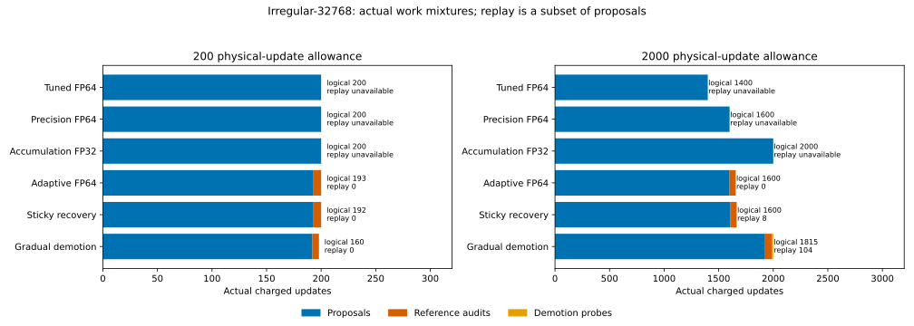
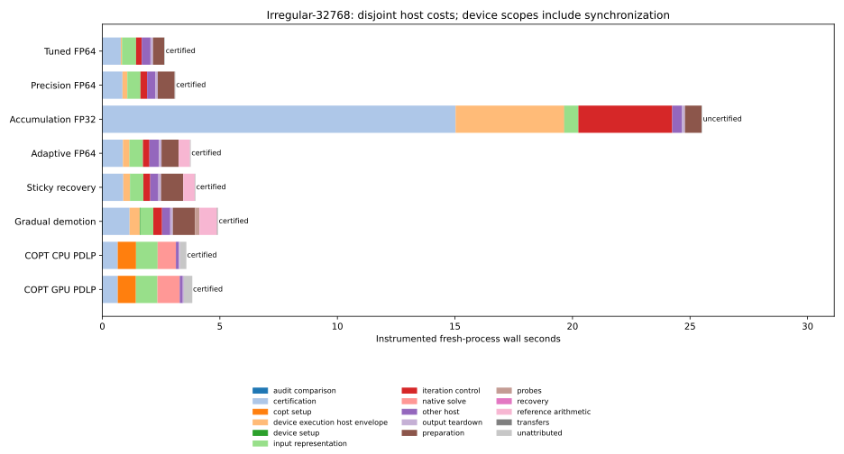

# Convergence and Work Amplification: GPUP-CONVERGENCE

This bounded study measures the work required by existing FP64, fixed FP32 and adaptive methods after the host repairs, alongside fresh scalar-wrapper COPT CPU/GPU PDLP controls. Original-model host certification remains authoritative. No arithmetic, kernel, solver default or supported preset changes.

On irregular-32768, accumulation FP32's recorded device-execution host cost per proposal is 10.1% lower than precision FP64 in the separate 2000-allowance profiles. Its full profile nevertheless consumes 40,464 proposals and fails certification; precision FP64 certifies after 1,600. This is a scoped per-work saving accompanied by substantial unsuccessful work, not a certified latency improvement.

The frozen **176-attempt** study retains **176 admitted attempts**, independently verifies **174 endpoints**, and certifies **87/104 primary timings**. The 72 separate bounded/full profiles certify 32 endpoints; reaching a deliberate short-work limit is a diagnostic outcome, not a successful primary timing.

[ADR-0032](../decisions/ADR-0032-convergence-diagnosis.md) was accepted before implementation under [SPEC-0013](../specifications/SPEC-0013-lp-precision-experiments.md). The [strict protocol](../../benchmarks/configs/lp-convergence-v1.json) records the complete schedule and settings.

## Protocol and reproducibility

Eight configurations retain their ADR-0026 settings. Three timing repetitions cover small-4, irregular-2048, irregular-32768 and dense_block-65536; mixed-65536 has one. Six project configurations receive separate 200/2000-physical-update profiles on small-4, irregular-2048, irregular-32768 and mixed-65536. All eight receive one full-limit profile on irregular-32768, dense_block-65536 and mixed-65536.

Use seed 17, one solver thread, 1e-9 final tolerances, 50000 full-run physical updates, 10-second ordinary and 30-second extension deadlines, plus two-second cleanup. Diagnostic work limits change both recorded iteration limits. Guards, stopping, audits and rollback remain active. Order seed 17001 is frozen. All GPU jobs use the shared host lease on GPU-dfb2449a-9eff-e868-3597-2c448c9a8e48. Model/host/device/output bounds remain 128 MiB / 8 GiB / 8 GiB / 32 MiB per file.

The process endpoint includes setup, solve, original-model certification and output. Subsequent independent verification is outside primary latency. Project evidence uses compact-v1; COPT retains external v2, COPT 8.0.6 and the unchanged scalar wrapper in the existing isolated adapter environment. Native COPT optimality is insufficient for project certification. Native iteration/seed controls remain limited, and internal COPT precision is unknown.

```sh
python3 tools/benchmark_lp_convergence.py --dry-run
python3 tools/report_lp_convergence.py
PYTHONPATH=/tmp/copt-plot-deps python3 tools/export_lp_convergence.py
```

Reporting and export are CPU-only. The last command uses the provisioned Matplotlib environment; its location is an environment prerequisite, not a runtime dependency. Measured archives remain under artifacts/gpup-convergence-v1 and acceptance under artifacts/gpup-convergence-acceptance. Admitted IDs cannot rerun.

All 176 cells were admitted; no cell was omitted by a category cap. Two accumulation-FP32 timings on dense_block-65536 (repetitions one and two) timed out without endpoint files. Their empty stdout/stderr and partial worker receipts remain archived. The other 174 complete endpoints independently verify, including unsuccessful numerical and interrupted outcomes. No admitted identity was retried. All eight mixed-65536 primary samples are uncertified; its single repetition has no repeatability interval.

| Block | Certified success | Work limit | Numerical rejection | Interrupted endpoint | No endpoint timeout |
| --- | ---: | ---: | ---: | ---: | ---: |
| Primary timing | 87 | 0 | 9 | 6 | 2 |
| 200-allowance profiles | 3 | 21 | 0 | 0 | 0 |
| 2000-allowance profiles | 15 | 9 | 0 | 0 | 0 |
| Full-limit profiles | 14 | 0 | 4 | 6 | 0 |

## Actual work mixtures

Adaptive physical work equals proposals + reference audits + demotion probes. Rejected and replay proposals overlap proposals and must not be added again. Equal allowances can yield different actual physical totals, proposal counts, logical progress and step sizes. Local audit agreement does not establish final convergence. COPT native iterations remain a separate unit.

| Irregular-32768 configuration | Allowance | Physical | Logical | Proposals | Audits | Probes | Replay subset |
| --- | ---: | ---: | ---: | ---: | ---: | ---: | ---: |
| Tuned FP64 | 200 | 200 | 200 | 200 | 0 | 0 | unavailable |
| Precision FP64 | 200 | 200 | 200 | 200 | 0 | 0 | unavailable |
| Accumulation FP32 | 200 | 200 | 200 | 200 | 0 | 0 | unavailable |
| Adaptive FP64 | 200 | 200 | 193 | 193 | 7 | 0 | 0 |
| Sticky recovery | 200 | 200 | 192 | 193 | 7 | 0 | 0 |
| Gradual demotion | 200 | 198 | 160 | 192 | 6 | 0 | 0 |
| Tuned FP64 | 2000 | 1400 | 1400 | 1400 | 0 | 0 | unavailable |
| Precision FP64 | 2000 | 1600 | 1600 | 1600 | 0 | 0 | unavailable |
| Accumulation FP32 | 2000 | 2000 | 2000 | 2000 | 0 | 0 | unavailable |
| Adaptive FP64 | 2000 | 1656 | 1600 | 1600 | 56 | 0 | 0 |
| Sticky recovery | 2000 | 1665 | 1600 | 1608 | 57 | 0 | 8 |
| Gradual demotion | 2000 | 2000 | 1815 | 1919 | 68 | 13 | 104 |

The following 2000-allowance profiles divide the recorded device-execution host envelope by actual proposals. These are scoped diagnostic costs, not kernel busy time or certified-solve latency. Audit/probe costs are separately charged.

| Irregular-32768 configuration | Actual proposals | Device host envelope ms | Microseconds per proposal |
| --- | ---: | ---: | ---: |
| Tuned FP64 | 1400 | 48.938 | 34.955 |
| Precision FP64 | 1600 | 204.063 | 127.539 |
| Accumulation FP32 | 2000 | 229.254 | 114.627 |
| Adaptive FP64 | 1600 | 274.041 | 171.276 |
| Sticky recovery | 1608 | 281.028 | 174.769 |
| Gradual demotion | 1919 | 321.442 | 167.505 |



The [work export](data/convergence/convergence-work.json) retains every verified endpoint’s assessment, transitions, per-rung proposals, observed step/operator bounds, restarts and assessments. Missing fields remain unavailable. The [amplification table](data/convergence/convergence-amplification.csv) computes cross-configuration ratios only for certified project pairs; failed or work-limited cells are never imputed.

The separate full-limit profiles expose controller progress and recorded numerical context:

| Configuration | Physical / logical | Step | Recorded operator bounds | Restarts / assessments | Endpoint |
| --- | ---: | ---: | --- | ---: | --- |
| Tuned FP64 | 1400 / 1400 | unavailable | unavailable | 6 / 8 | certified_success |
| Accumulation FP32 | 40464 / 40400 | 0.590669519094 | 1.52369467343 / 1.52369465964 | 13 / 203 | numerical_rejection |
| Sticky recovery | 1665 / 1600 | 0.590669519094 | unavailable | 7 / 9 | certified_success |
| Gradual demotion | 2643 / 2400 | 0.590669519094 | unavailable | 8 / 13 | certified_success |
| Adaptive FP64 | 1656 / 1600 | 0.590669519094 | unavailable | 7 / 9 | certified_success |
| Precision FP64 | 1600 / 1600 | 0.590669519094 | 1.52369467343 / 1.52369467343 | 7 / 9 | certified_success |

The two fixed-precision bounds are the recorded reference/represented operator bounds. Adaptive and tuned endpoints do not expose these bounds, and tuned endpoints do not expose a step; these values remain unavailable. The equal recorded step for precision and adaptive runs does not imply an equal trajectory. Sticky recovery rejects/replays eight proposals and promotes at logical iteration 192. Gradual recovery rejects/replays 136 proposals, promotes through the ladder, demotes once, then returns to FP64. Its 2536 proposals + 89 audits + 18 probes charge 2643 physical updates for 2400 logical updates. COPT CPU/GPU each record 80 native iterations in this full profile, a different unit.

The accumulation-FP32 full profile stops with numerical_failure and the recorded range_guard_slot_88149_bits_4 after 64 rejected proposals; its matrix_max_error is 1.3967696887995373e-08. These observations do not isolate whether operator representation, accumulation error or restart dynamics causes the unsuccessful fixed-FP32 trajectory. Those remain hypotheses for targeted work; lower device cost per proposal and local audit agreement alone do not establish final convergence.

## Certification coverage and fresh latency

Cells below give certified median seconds and certified/planned timings. A missing median means no certified primary sample. Three development repetitions establish no general recipe. Paired ratios and 95% intervals use 10000 bootstrap resamples, seed 17002; mixed-65536 has no repeatability interval.

| Configuration | small-4 | irregular-2048 | irregular-32768 | dense-65536 | mixed-65536 |
| --- | ---: | ---: | ---: | ---: | ---: |
| Tuned FP64 | 0.4141 (3/3) | 0.5021 (3/3) | 2.6467 (3/3) | 6.4145 (3/3) | unavailable (0/1) |
| Precision FP64 | 0.3629 (3/3) | 0.5771 (3/3) | 3.1568 (3/3) | 8.1568 (3/3) | unavailable (0/1) |
| Accumulation FP32 | 0.3633 (3/3) | unavailable (0/3) | unavailable (0/3) | unavailable (0/3) | unavailable (0/1) |
| Adaptive FP64 | 0.3527 (3/3) | 0.5801 (3/3) | 3.7328 (3/3) | 9.5574 (3/3) | unavailable (0/1) |
| Sticky recovery | 0.3657 (3/3) | 0.5945 (3/3) | 3.9947 (3/3) | 10.3343 (3/3) | unavailable (0/1) |
| Gradual demotion | 0.3635 (3/3) | 0.6597 (3/3) | 4.9922 (3/3) | 13.2870 (3/3) | unavailable (0/1) |
| COPT CPU PDLP | 0.2672 (3/3) | 0.4171 (3/3) | 3.5685 (3/3) | 9.2406 (3/3) | unavailable (0/1) |
| COPT GPU PDLP | 0.7226 (3/3) | 0.8433 (3/3) | 3.8078 (3/3) | 8.9383 (3/3) | unavailable (0/1) |

All [trial outcomes](data/convergence/convergence-trials.csv), [paired ratios](data/convergence/convergence-summary.json), missing cells and verification failures remain visible. Ratios compare paired certified repetitions; medians alone do not imply a significant improvement. No timeout or rejected COPT endpoint is treated as a certificate.

Paired fresh-process ratios below are tuned FP64 time divided by candidate time; values above one favor the candidate. Only certified paired repetitions enter the estimate. Each interval is scoped to three development repetitions.

| Candidate | irregular-32768 ratio [95% interval] | dense-65536 ratio [95% interval] |
| --- | ---: | ---: |
| Precision FP64 | 0.849 [0.838, 0.858] | 0.785 [0.783, 0.789] |
| Adaptive FP64 | 0.712 [0.708, 0.718] | 0.670 [0.670, 0.671] |
| Sticky recovery | 0.665 [0.663, 0.673] | 0.620 [0.619, 0.625] |
| Gradual demotion | 0.535 [0.527, 0.538] | 0.482 [0.477, 0.486] |
| COPT CPU PDLP | 0.742 [0.737, 0.753] | 0.696 [0.694, 0.696] |
| COPT GPU PDLP | 0.699 [0.694, 0.702] | 0.716 [0.714, 0.727] |

The scoped ratios compare complete fresh processes, including scalar COPT construction and certification. They do not identify a kernel winner or support a general preset.

## Remaining cost

The following are separate single full-limit profiles on irregular-32768, in seconds. Components partition host wall time using exclusive scopes. The device-execution envelope includes host submission and synchronization; it is not measured GPU busy time. Child certifier cost is retained separately without adding it to its containing parent again. Certification includes repeated original-model assessments during solving as well as endpoint checks; output is retained as its own group in the export and figure.

| Configuration | Process | Preparation | Reference arithmetic | Audit comparison | Probes | Device envelope | Certification |
| --- | ---: | ---: | ---: | ---: | ---: | ---: | ---: |
| Tuned FP64 | 2.6659 | 0.4741 | 0.0000 | 0.0000 | 0.0000 | 0.0489 | 0.7856 |
| Precision FP64 | 3.1084 | 0.7170 | 0.0000 | 0.0000 | 0.0000 | 0.2028 | 0.8583 |
| Accumulation FP32 | 25.5201 | 0.7060 | 0.0000 | 0.0000 | 0.0000 | 4.6214 | 15.0272 |
| Adaptive FP64 | 3.7619 | 0.7287 | 0.4736 | 0.0177 | 0.0000 | 0.2774 | 0.8590 |
| Sticky recovery | 3.9642 | 0.9441 | 0.4799 | 0.0172 | 0.0000 | 0.2801 | 0.8749 |
| Gradual demotion | 4.9238 | 0.9453 | 0.7415 | 0.0310 | 0.1815 | 0.4303 | 1.1293 |
| COPT CPU PDLP | 3.5754 | unavailable | unavailable | unavailable | unavailable | unavailable | 0.6553 |
| COPT GPU PDLP | 3.8277 | unavailable | unavailable | unavailable | unavailable | unavailable | 0.6566 |

Zeros in this scoped component table mean no recorded operation in that group; opaque COPT arithmetic is retained under its native solve envelope, not inferred as zero work. All groups, unclosed-scope flags and unattributed residuals remain in the [profile export](data/convergence/convergence-profiles.json).



Full-profile versus timing-repetition-zero numerical/work comparisons: 19 match, 5 differ, 0 are unavailable. Deadline-limited trajectories can differ; those comparisons do not establish profile equivalence. The separate non-binding fixed-work acceptance is the instrumentation equivalence gate.

## Acceptance and resources

The full pinned-native tools/check.sh gate passes before admission and at completion, including exact-rational certification regressions. All 58 regular device tests pass. Twelve profile-off/on pairs and twelve compact replays match numerical bits, execution observations and work; all 36 endpoints independently verify. Eight fresh COPT CPU/GPU min/max/profile endpoints certify and preserve their numerical/work identity and offset.

Ten source-only contracts pass in a clean copy. CPU review reproduced activity-file mutation before duplicate refusal and recovery failure on non-object JSON. The reviewed coordinator refuses before writes and retains malformed bytes; reporting leaves missing worker envelopes unavailable. The [exact correction record](data/convergence/convergence-review-corrections.json) binds three CPU-only coordinator/report/export repairs to both source versions. Figure labels also preserve unavailable replay observations instead of printing zero. Measured solver workers, binary, schemas, protocol, code objects, results and ledger are unchanged. Failed-outcome fixtures are synthetic CPU tests, not study retries.

No fresh sanitizer workload is needed for unchanged runtime/kernel bytes. Existing adaptive and primary sanitizer receipts carry forward only for their scopes; the historical tuned_cases racecheck gap and old large-session limits remain open.

Task GPU charge: **1311.088550794 seconds**: timing 634.748860654/800, profiles 441.911765452/800, acceptance 234.427924688/300. Combined cap 1900; additional allowance zero. Cumulative charge: **17115.274617853 / 18002.574545061 seconds**. Every original phase cap remains authoritative. The cumulative ceiling has 887.299927208 seconds remaining; this study grants no additional allowance to GPUP-7.

The **16134-event** ledger SHA-256 is `60649d29992d21508e60aa60f3e334e9ac18fe3254525ec38cc0eef298e84823`. Its 15776-event prefix remains `2b99b615dc77da07fb078e1cefc188d2131db5ca671fe9b86f989a6d660606f0`, preserving all previous prefixes and the original output binding.

The [resource catalog](data/convergence/convergence-resources.json) retains metered child CPU receipts against 14400 seconds and four build jobs. The [source/ledger audit](data/convergence/convergence-source-ledger-audit.json) and [artifact catalog](data/convergence/convergence-provenance.json) bind archived artifacts and unchanged historical authority.

## Interpretation and GPUP-7 handoff

The tuned irregular-32768 profile spends 1.84% of its process envelope in recorded device execution. Removing that entire measured host envelope would bound this profile's speedup at 1.019x if all other work and costs stayed unchanged. This is an illustrative profile bound, not a measured optimization or a universal kernel limit. Sticky/gradual recovery additionally retain reference arithmetic and probes; their costs must accompany any proposal-width comparison.

This study is a bounded diagnosis. Faster arithmetic must be evaluated together with proposals, audits, probes, replay, certification coverage and complete fresh-process cost. A physical-update total alone is insufficient: adaptive methods spend different mixtures, use conservative configured steps and may roll back logical progress.

GPUP-7 must specify its quantization/FP8 interface and resource contract before behavior. Its screening should retain a matched FP64 control, original-model certification, explicit represented-operator and step observations, charged recovery and failure coverage. Short-work arithmetic savings cannot substitute for a certified latency endpoint. Required reference arithmetic and original-model assessments remain costs unless a separate accepted numerical contract changes them.

Historical [COPT component results](lp-copt-comparison.md), [adaptive host repairs](lp-adaptive-host-cost.md), and [scalar/bulk construction results](lp-copt-adapter.md) remain separately labeled context. This study does not populate their missing cells or pool their timings. Mixed-model convergence, COPT graph internals, large sessions and the old racecheck receipt remain limitations. No preset, tolerance relaxation, graph trace or implicit solver tuning follows.
