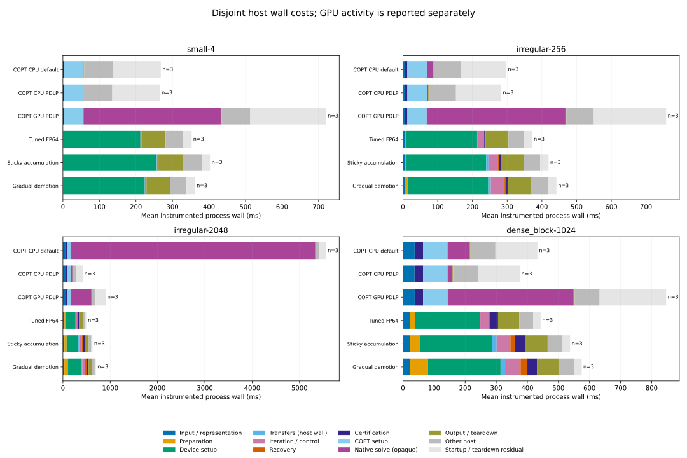
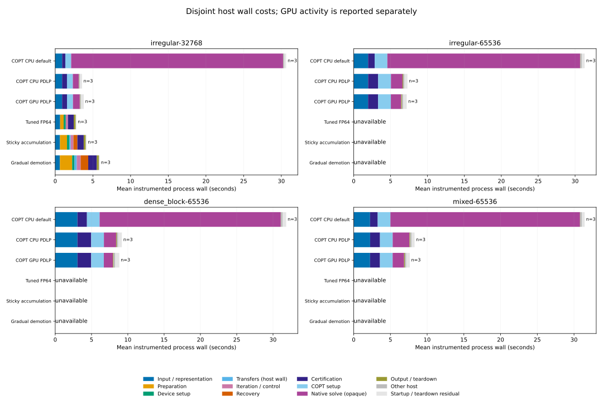

# COPT comparison and component-cost diagnosis

All **1140 frozen attempts ran**; **948 endpoints independently verify**, and
**402/816 primary attempts certify** under the common original-model 1e-9 checks.
The study is incomplete for performance ranking: 192 attempts across all blocks
lack complete endpoints, including large project outputs that hit the frozen
32 MiB file cap. No winner or supported preset is selected.

The main measured directions are evidence size at 65536 rows, repeated host
representation/preparation/checking at 32768 rows, and adaptive ladder/audit cost.
Tuned FP64's primary median on irregular-32768 is **2.811 s**, against COPT CPU
PDLP **3.547 s** and GPU PDLP **3.736 s**. On small-4, pinned HiGHS and host LP
are about **7 ms**; tuned FP64 is **353 ms**, while this COPT adapter takes
**267 ms CPU / 678 ms GPU**. These are fresh certified process endpoints, including
wrapper costs, not native solver speed rankings.

This implements [ADR-0026](../decisions/ADR-0026-copt-component-diagnosis.md) and
[SPEC-0013](../specifications/SPEC-0013-lp-precision-experiments.md), using the
[frozen protocol](../../benchmarks/configs/lp-copt-comparison-v1.json).
Optimization itself remains a subsequent task.

## Data and reproducibility

[Summary](data/copt/copt-summary.json), [all trials](data/copt/copt-trials.csv),
[coverage and primary medians](data/copt/copt-latency.csv),
[paired ratios and intervals](data/copt/copt-ratios.csv),
[inclusive/exclusive scopes](data/copt/copt-scopes.csv),
[disjoint component means](data/copt/copt-components.csv),
[per-unit observations](data/copt/copt-per-unit.csv), and
[process resources](data/copt/copt-resources.csv) are repository data.
The [compressed full analysis](data/copt/copt-analysis.json.gz) is the exact JSON
report, including every work counter, per-rung path, native observation, trace
summary, independent assessment, missing observation and uncertainty interval.
Use `gzip -dc` or Python `gzip.open` to read it. The
[provenance catalog](data/copt/copt-provenance.json) binds the published data and
retained local evidence by SHA-256.

Raw attempts, models, partial files, logs, trace exports, source archive, schemas,
executables and four code images remain in `artifacts/gpup-copt-comparison-v1`.
Acceptance receipts are in `artifacts/gpup-copt-acceptance`; raw artifacts and
COPT license files are not committed. Measured source tree:
`d9e074cd266e371446c0711aca3cc85cabe7bf82bdb49bce1fbb2e99fc4a83b4`.
The later verifier is separately archived and hash-bound; no solve was rerun.
Host: Linux 5.19.0-32-generic, RTX 5090
`GPU-dfb2449a-9eff-e868-3597-2c448c9a8e48`, driver 580.105.08,
Rust 1.93.1, CPU affinity [0], local COPT 8.0.6.

## Frozen methods and observations

The frozen `gpup-copt-comparison-v1` protocol includes 17 configurations on the
original twelve development instances and all four existing extensions through
65536 rows. The six established controls, five fixed-precision modes, three
adaptive policies and three COPT modes retain the requested settings. Adaptive
policies use interval 32 and primal/dual/relative audit tolerances 1e-7; the gradual
working-state policy demotes after four clean windows with margin 0.25. Original-model
host feasibility, objective and conservative dual certification remain authoritative.

COPT 8.0.6 default CPU LP uses LpMethod=-1, GPUMode=0 and default crossover.
CPU/GPU PDLP uses LpMethod=6, Crossover=0 and explicit GPUMode. Threads=1,
FeasTol/DualTol=1e-9 and PDLP tolerance=1e-9 where applicable. COPT's native
simplex/barrier/PDLP iteration counters remain separate; an aggregate above 50000
is work-limited. These are different units from project physical updates, and COPT
has no equivalent hard iteration limit or seed control. GPU discovery, a GPU request,
CPU fallback or presolve-only execution never qualifies as successful GPU PDLP.

All methods retain final tolerances 1e-9, seed 17, single-CPU affinity, ten-second
original-model or thirty-second extension process deadlines and two seconds of
cleanup. Bounded-work diagnostics use 200 physical updates with ordinary stopping
and guards. Audit/probe work is charged; rejected/replay counters overlap proposals.

The ordering is acceptance, timing repetition zero, repeated profiles, bounded work,
remaining profiles, traces, then timing repetitions one and two. Configurations are
randomized within paired blocks with seed 17001. No attempted identity is retried.
Paired median ratios and 95% bootstrap intervals use seed 17002 and 10000 resamples;
three repetitions provide limited uncertainty information. Missing pairs remain empty.

Primary timing is supervised fresh-process launch through certified output, including
front-end processing, setup, iteration, checks and serialization. Subsequent independent
CPU verification has a separate 120-second bound. Profiles/traces never replace primary
timing samples. Hierarchical host costs report inclusive and exclusive durations;
exclusive leaf/self costs are summed for disjoint charts. The Rust certifier subprocess
is a child of COPT's host-certification phase, not an additional top-level duration.
Startup, profile output, Python/native destruction and other unscoped work remain
in an explicit process residual.

COPT `SolvingTime`, `MemPeak` and iterations are native API reports. Presolved dimensions
and callback phase messages are coarse log observations; callback timestamps are delivery
times, not exact internal phase boundaries. Native CPU presolve/scaling/arithmetic
internals remain opaque. A zero native memory report is the solver's observation,
not a claim of zero process memory. Process-tree RSS is recorded separately.

Nsight Systems 2025.3.0 traces are separate executions with unchanged native solve
limits, fifteen extra supervisor seconds and a 512 MiB per-file trace output bound.
Exports are offline CPU work. Device interval unions, overlap, stream timelines,
launch geometry, memory-copy bytes, allocation/free APIs and runtime/driver correlations
are separate from host wall costs. One graph launch can execute many kernels.
Kernel names do not establish COPT's arithmetic precision or proprietary algorithms.
Existing hardware-counter and CPU-sampling restrictions are unchanged.

## Coverage and certified latency

| Block | Attempted / planned | Verified endpoints | Missing complete endpoints |
|---|---:|---:|---:|
| Primary timings | 816 / 816 | 699 | 117 |
| Component profiles (144 repeated + 88 coverage) | 232 / 232 | 175 | 57 |
| Bounded work | 72 / 72 | 54 | 18 |
| Separate traces | 20 / 20 | 20 | 0 |
| Total | 1140 / 1140 | 948 | 192 |

A verified endpoint can report a limit or numerical rejection; verification alone
does not certify success. There are 556 certified completed outcomes across all
blocks. Initially 519 qualified; 88 complete endpoints encountered the verifier
input-limit omission described below, and correcting only that reader recovers
37 certified outcomes (21 primary). Original trial statuses remain immutable.
The initial ledger of outcomes is 519 completed/certified, 9 feasible/unclosed,
117 numerical rejections, 163 work limits, 3 backend failures, 88 invalid evidence,
82 process failures, 110 timeouts without endpoint, and 49 timeouts retaining an
endpoint (42 interrupted, 4 numerical, 3 work-limited).

The table reports certified primary repetitions. Each original cell has 36
possible samples per configuration and each extension group has 12. Short aliases
are expanded in the protocol and CSVs; “gradual” includes all five configured rungs.

| Configuration | Original /36 | Extension /12 | Total /48 | Initially certified |
|---|---|---|---|---|
| highs | 30 | 0 | 30 | 30 |
| host-lp | 27 | 3 | 30 | 27 |
| cuda-lp | 6 | 0 | 6 | 6 |
| matched-fp64 | 27 | 3 | 30 | 27 |
| tuned-fp64 | 27 | 3 | 30 | 27 |
| precision-fp64 | 27 | 3 | 30 | 27 |
| storage-fp32 | 12 | 0 | 12 | 12 |
| products-fp32 | 12 | 0 | 12 | 12 |
| accumulation-fp32 | 12 | 0 | 12 | 12 |
| master-correction32 | 12 | 0 | 12 | 12 |
| working-fp32-correction32 | 6 | 0 | 6 | 6 |
| adaptive-fp64-a32 | 27 | 3 | 30 | 27 |
| adaptive-direct-accumulation_fp32-a32-strict-sticky | 27 | 3 | 30 | 27 |
| adaptive-gradual-working_fp32-a32-strict-demote | 27 | 3 | 30 | 27 |
| copt-cpu-default | 33 | 0 | 33 | 33 |
| copt-cpu-pdlp | 27 | 9 | 36 | 36 |
| copt-gpu-pdlp | 24 | 9 | 33 | 33 |

Selected primary medians in seconds (certified repetitions in parentheses):

| Configuration | small-4 | irregular-2048 | irregular-32768 | dense_block-65536 |
|---|---|---|---|---|
| highs | 0.0072 (3/3) | unavailable (0/3) | unavailable (0/3) | unavailable (0/3) |
| host-lp | 0.0073 (3/3) | 1.6656 (3/3) | 28.3087 (3/3) | unavailable (0/3) |
| tuned-fp64 | 0.3526 (3/3) | 0.5133 (3/3) | 2.8111 (3/3) | unavailable (0/3) |
| adaptive-direct-accumulation_fp32-a32-strict-sticky | 0.3860 (3/3) | 0.6315 (3/3) | 4.1365 (3/3) | unavailable (0/3) |
| adaptive-gradual-working_fp32-a32-strict-demote | 0.3317 (3/3) | 0.6600 (3/3) | 5.8628 (3/3) | unavailable (0/3) |
| copt-cpu-default | 0.2669 (3/3) | 5.5706 (3/3) | unavailable (0/3) | unavailable (0/3) |
| copt-cpu-pdlp | 0.2672 (3/3) | 0.4172 (3/3) | 3.5466 (3/3) | 9.1117 (3/3) |
| copt-gpu-pdlp | 0.6779 (3/3) | 0.8318 (3/3) | 3.7361 (3/3) | 8.7962 (3/3) |

Pair ratios below are COPT latency / tuned FP64 latency; above one favors tuned.
They are medians of repetition-paired ratios, with 10000-resample 95% bootstrap
intervals. Three pairs cannot characterize host-to-host or long-term uncertainty.

| Instance | COPT CPU PDLP / tuned | COPT GPU PDLP / tuned | Pairs each |
|---|---:|---:|---:|
| small-4 | 0.758 [0.641, 0.840] | 1.922 [1.611, 2.111] | 3 |
| irregular-2048 | 0.813 [0.761, 0.822] | 1.621 [1.516, 1.859] | 3 |
| irregular-32768 | 1.262 [1.256, 1.280] | 1.329 [1.317, 1.357] | 3 |

The 32768-row project samples are explicitly reverified input-limit recoveries.
No 65536-row project primary sample certifies; trace-only outputs cannot fill those
cells. COPT PDLP certifies irregular-65536 and dense_block-65536 but not mixed-65536
under the shared checker. COPT default LP also fails to certify any extension
within this contract. This is development coverage, not a general solver ranking.

## Measured host costs

These charts include unsuccessful completed profiles, such as time-limited COPT
default LP. Missing project profiles at 65536 rows remain unavailable. Colors
partition exclusive host scope/self time; a parent and its children are never
added. The unexplained startup/teardown residual closes each observed process wall.
The underlying recorded scope CSV, rather than absent bars, distinguishes missing
observations from zero durations. Secondary certifier detail is nested inside
COPT's host-certification envelope.

Mean seconds over three repeated profiles on irregular-32768:

| Method | Process | Input / representation | Preparation | Certification | Iteration/control or native solve | Recovery |
|---|---:|---:|---:|---:|---:|---:|
| Tuned FP64 | 2.801 | 0.652 | 0.469 | 0.760 | 0.291 | 0 |
| Sticky accumulation | 4.144 | 0.633 | 0.935 | 0.838 | 0.365 | 0.525 |
| Gradual demotion | 5.881 | 0.624 | 1.626 | 1.137 | 0.513 | 1.006 |
| COPT CPU PDLP | 3.561 | 0.913 | opaque | 0.647 | 0.780 | unavailable |
| COPT GPU PDLP | 3.788 | 0.914 | opaque | 0.650 | 0.906 | unavailable |

Remaining COPT setup is 0.776/0.788 s for CPU/GPU, including about 0.552/0.555 s
of constraint construction. Unexplained process residuals are 0.267/0.351 s.
For tuned FP64, norm/step estimation alone averages 0.366 s, conservative dual
certification 0.297 s, and candidate checks 0.277 s. These named scopes are parts
of the table, not extra additive costs. COPT CPU default spends 28.113 of its
30.648 s in solveLP on this instance but does not certify.

Small-4 tuned FP64 spends 0.211 of 0.353 s in device setup, 0.065 s in
output/teardown, and about 0.0033 s in iteration/control. COPT CPU PDLP spends
only about 0.0005 s in solveLP; binding import is about 0.050 s, environment/license
initialization 0.0027 s, root self time 0.078 s, and process residual 0.131 s.
COPT GPU PDLP's solveLP wall rises to 0.376 s. Root self includes provenance
hashing and unscoped orchestration; residual includes startup and native cleanup.
Those categories do not justify assigning all the time to any one cause.

On dense_block-65536, COPT CPU/GPU PDLP process means are 9.182/8.832 s;
input/representation is 3.067/3.069 s, setup 1.757/1.744 s, certification
1.884/1.883 s, and solveLP 1.677/1.242 s. Faster native GPU solving saves about
0.435 s inside the measured envelope, while the complete process difference is
about 0.350 s. Host construction and checks dominate both paths at this size.

For gradual demotion on irregular-32768, inclusive operator preparation is
1.157 s, audits 0.798 s, demotion probes 0.197 s, checkpoint copying 0.0068 s,
rollback 0.00044 s, adoption 0.0038 s and residency reconstruction 0.053 s.
Sticky audits cost 0.517 s, with 0.0046 s checkpoint copying. Replay envelopes
are 0.128/0.226 s for sticky/gradual and overlap proposal computation. Nested
inclusive values must not be summed into a second wall-time decomposition.
Per-rung `windows` in the full analysis counts scope invocations, including
admission/replay attempts; it is not a count of committed windows.

Illustrative per-unit observations from profile repetition zero on irregular-32768:

| Method / measured envelope | Recorded units | Mean cost per unit |
|---|---:|---:|
| Tuned kernels plus synchronization / proposal | 1400 | 34.950 microseconds |
| Gradual kernels plus synchronization / proposal | 2536 | 169.436 microseconds |
| Gradual reference audit | 89 | 8.943 ms |
| Gradual demotion probe | 18 | 10.873 ms |
| Tuned host checks / controller assessment | 8 | 72.250 ms |
| Gradual host checks / controller assessment | 13 | 73.336 ms |
| COPT CPU solveLP / native PDLP iteration | 80 | 9.703 ms |
| COPT GPU solveLP / native PDLP iteration | 80 | 11.688 ms |

These divide the named enclosing phase by its observed count; they are not pure
arithmetic latency and do not have interchangeable work units. The proposal
envelope excludes adaptive reference work; native averages include solveLP setup.
Tuned host transfer envelopes average about 0.17 ns/upload byte and 0.17 ns/readback
byte for 19,914,744 and 3,670,016 bytes. Gradual averages about 0.12/1.21 ns per byte
for 198,137,144/230,162,432 bytes. These include host API/wait costs and are not
claims of device-link bandwidth. Raw counts, exact paths and null unavailable
values are retained; readback and residency changes explain much larger adaptive
movement volumes.

## Separate GPU observations

[Small-4 timeline](data/copt/copt-timeline-small-4.svg),
[irregular-2048 timeline](data/copt/copt-timeline-irregular-2048.svg),
[irregular-32768 timeline](data/copt/copt-timeline-irregular-32768.svg), and
[mixed-65536 timeline](data/copt/copt-timeline-mixed-65536.svg) show streams,
visible kernels/copies/fills and graph envelopes separately from host charts.

On irregular-32768, tuned FP64 executes 8400 observed kernels whose interval
union is 37.381 ms; copies occupy 2.001 ms, with no observed kernel/copy overlap.
The activity-free span between the first and last observation is 711.500 ms.
Accumulation FP32 executes 242784 kernels and spends 3667.505 ms in their union;
its 20.269 ms copy union is small beside 20299.780 ms outside activity envelopes.
Sticky and gradual recovery execute 9648 and 15216 kernels, respectively, with
161.326/243.930 ms kernel unions and 6.240/16.093 ms copy unions. These are
separate profiled trajectories, potentially limited; per-kernel gains cannot
be substituted for certified solve gains or matched-work comparisons.

COPT's traces use Nsight's default graph granularity. On small-4, 24 individually
visible kernels and 3 graph envelopes cover 0.265 ms in total observed device
envelopes; on irregular-32768, 26 visible kernels and 97 graphs cover 5.263 ms.
The graph unions themselves are 0.217 and 4.051 ms. Internal graph-node kernel
counts/durations and exact busy time inside graphs are **unavailable**. The full
analysis sets total executed kernel count to null for these traces. A graph
launch is never treated as one executed kernel. A future node-granularity trace
would add overhead and requires its own bounded experiment.

API-family classification uses documented `cu*` / `cuda*` names while retaining
the original Nsight table: this installation also places driver calls in the
runtime activity table. Counts, durations, direction/bytes, allocation/free,
geometry, correlation groups and graph launches are retained in the analysis.
For example COPT small-4 records 63 cudaFree calls with summed API wall 130.608 ms
and 43 cudaMallocAsync calls with 7.763 ms. This cannot establish that all that
wall is allocation/free work; initialization and waits can be inside those calls.
API durations are not added to host decomposition or device interval unions.

The first offline QdstrmImporter appended telemetry metadata to the raw capture
files, and checksum verification correctly stopped report attempt 01. All 20
original captures were subsequently restored **byte-for-byte against their
pre-import full SHA-256 hashes**; importer-modified copies and the exact-recovery
receipt remain retained. No integrity requirement was waived. Future decoding
imports a working copy, verifies the original stayed unchanged, and records
importer/library hashes. The successful report uses the restored originals and
retained offline derivatives. No trace execution was repeated.

## Profiling overhead and equivalence

[Profile overhead](data/copt/copt-overhead.json),
[bitwise comparisons](data/copt/copt-equivalence.json), and
[trace overhead](data/copt/copt-trace-overhead.json) retain every pair and omission.
All 132 comparable certified completed profile/timing pairs are bitwise equal;
100 pairs are unavailable for that comparison, not mismatches converted to passes.
The six fixed-work acceptance configurations additionally match their record,
control/precision/adaptive state, dual, assessment iteration and restarts bitwise.

Profile/ordinary paired median ratios on irregular-32768 are 0.998
[0.994,1.006] for tuned FP64, 1.003 [0.968,1.019] sticky, 1.003 [0.998,1.017]
gradual, 1.004 [0.997,1.009] COPT CPU PDLP, and 1.014 [0.999,1.023] GPU PDLP.
Small-4 COPT GPU profiling is 1.088 [1.014,1.097]. These separate executions
include normal variability, so a ratio below one is not evidence that collection
accelerates solving. Native limits remain unchanged, and incomplete/time-limited
outcomes remain retained.

Trace process ratios include profiler startup/finalization and only one sample.
Small-4 ratios range from 6.14x for COPT GPU to 12.44x for tuned FP64;
irregular-32768 certified pairs range 1.71–2.56x. Trace ratios are not primary
latency or a correction factor to subtract from it. Sixteen trace endpoints have
ordinary endpoints available and match numerical state; four lack a comparison.
Thirteen pairs qualify for certified process ratios, as recorded in the data.

## Interpretation and attribution limits

Every result uses the same original-model host assessment. A native COPT optimal
status is an observation, not a replacement certificate. On mixed-65536, both
COPT PDLP modes report native optimality after 200 native PDLP iterations, but
our original-model assessment rejects the endpoint at 1e-9 and cannot establish
a finite conservative bound: a reduced-cost enclosure points toward an infinite
variable bound. This is a difference between the shared certificate and the
native stopping outcome; it does not by itself establish that COPT is incorrect.
On scaling-256, COPT endpoints can be feasible without closing the required gap.
Native iteration allowance violations remain work-limited even if a native solver
reports optimality. No tolerance or import guard was relaxed.

COPT timings here include its Python adapter, library identity checks, input and
model construction, original-model certification and output. They are fresh
certified process latencies. They are not measurements of solveLP alone and do
not establish the latency of a different native COPT integration. Native
SolvingTime and the instrumented solveLP envelope are separately available. The
project's host LP, HiGHS and CUDA methods likewise retain their ordinary frontend,
representation, original-model checks and endpoint writing. This distinction is
especially material on the smallest models, where solving is a small fraction
of the wrapper's process lifetime.

The host charts sum exclusive scope/self costs, including an explicit residual,
to mean observed process wall time. They do not add inclusive parents to their
children. The Rust certifier subprocess inside a COPT execution provides detail
within the COPT host_certification envelope; it is never added as another process
cost. The raw CSV retains inclusive and exclusive values and counts for every
recorded path. Missing scopes, failed profile output and opaque native phases
remain unavailable; an absent bar does not establish a zero underlying cost.

CUDA charts use interval unions and actual stream activity. Their clock begins
at the first observed device activity, not process launch. Activity-free time
inside that span is not classified as a specific CPU operation without a matching
observation. Kernel and copy sums can overlap; their union and intersection are
reported explicitly. Runtime and driver API walls can overlap and are not
additional disjoint process phases. One graph launch can correlate to multiple
executed kernels. Names, geometry and duration are observations, not evidence of
COPT's arithmetic width or undocumented algorithms.

Host profiles do not resolve every requested category into a standalone cost.
Python startup before the collector, its final profile writing, native destruction
beyond reference release and process exit remain in a residual. Unscoped project
orchestration/discovery and COPT provenance hashing remain in root self time;
there is no valid breakdown of those self costs into their individual causes.
Host allocation timing covers scoped preparation and working-state allocation,
not a process-wide allocator trace. Native COPT CPU presolve, scaling and iteration
internals remain opaque. Log timestamps are callback delivery observations; they
are not exact native phase boundaries. Hardware counters and CPU sampling remain
unavailable under the existing host restrictions.

## Retained large-model evidence failures

The explicit 128 MiB study allowance initially reached model loading but not
endpoint loading in the independent verifier. Complete project endpoints around
32 MB at irregular-32768 were therefore initially marked invalid_evidence by the
archived verifier's 16 MiB reader. The final implementation applies the same
explicit allowance to both model and evidence. Its regression rejects a padded
17 MiB endpoint by default, accepts it with the explicit 128 MiB allowance, and
rejects a requested allowance above the maximum. Ordinary CLI input remains
16 MiB. This parser correction changes no arithmetic, stopping rule, evidence
bytes, solve request or primary timing.

Initial trial records, verifier errors and measured executables remain immutable.
The final analysis separately binds the corrected verifier, independently assesses
the unchanged endpoints, and records both initial and final qualification. Only a
completed worker with a verified certificate and matching execution identity can
qualify for latency. Timeouts, process failures and truncated output never become
successful timing samples through re-verification. No solve was retried.

A separate retained failure is the normal study's frozen 32 MiB per-file output
cap. Several 65536-row project runs reach that limit while atomically writing an
endpoint: the retained .endpoint.partial is exactly 33554432 bytes, the worker
reports SIGXFSZ (-25), and no final endpoint exists. Other runs reach their
32-second process-plus-cleanup limit. These are output/deadline coverage failures,
not evidence of failed GPU arithmetic. The trace-only 512 MiB allowance permits
some larger endpoints to be retained, but traced results never fill primary
latency cells. All partial files and unsuccessful identities remain catalogued.

The output structure itself is a useful diagnosis. On irregular-32768, the
retained tuned FP64 endpoint is 32280626 bytes and the sticky recovery endpoint
is 31752481 bytes; independently certified COPT CPU/GPU PDLP endpoints in the
same first repetition are about 2.06 MB. Within the project record, the validation
object alone occupies 16403371 compact JSON bytes of 17753520 compact record
bytes. These are byte counts, not a claim that serialization consumes the same
fraction of runtime. Reducing evidence size is first an availability/copying
proposal; its speed benefit requires a separate controlled experiment.

## Bounded work and convergence

The short diagnostic is a 200-physical-update allowance, not a demand to execute
200 GPU proposals. Ordinary stopping, guards, audits and rollback remain active.
For irregular-32768 repetition zero, tuned FP64, precision FP64 and accumulation
FP32 each record 200 physical/logical proposals. Adaptive FP64 records 193 proposals
and seven audits; sticky accumulation also spends 193 proposals and seven audits
but commits only 192 logical updates. The gradual policy records 192 proposals
and six audits (198 physical updates), with 160 committed logical updates. A
remaining allowance insufficient for the next reserved audit is not spent.
These are different work mixtures, even where their physical totals equal 200.

Rejected and replay proposal counters are overlapping subsets of proposed work;
they must not be added to physical updates or interpreted as disjoint wall costs.
The report keeps per-rung proposal/window, audit, probe and transition observations,
with inclusive replay windows separately identifiable in the raw paths. Native
COPT simplex, barrier and PDLP iterations, and HiGHS simplex iterations, use their
own labels. No throughput equivalence is inferred between those units and project
PDHG updates.

Fixed-work, non-binding-deadline acceptance compares all six project short-run
configurations with collection off/on. The numerical record, control/precision/
adaptive state, dual vector, iteration count, assessment iteration and restarts
are bitwise equal. Actual device allocated/upload/readback byte counters match
the corresponding execution evidence. Repeated ordinary profile-to-timing ratios
still include run variability and any deadline-induced outcome differences;
they do not isolate a universal instrumentation surcharge. Incomplete pairs are
retained rather than imputed. Traces are a separately instrumented endpoint.

## Ranked next experiments

The ranking prioritizes coverage and end-to-end costs, not a precision preset.
Bounds assume the measured profile fractions represent ordinary runs and all
other phases/work remain unchanged; uncertainty and profiling effects still apply.

| Priority | Evidence and affected work | Plausible benefit / limit | Correctness risk and next bounded experiment |
|---|---|---|---|
| 1. Compact project evidence | 148 partial endpoint files; 142 hit exactly 32 MiB, and 65536-row primary project coverage is absent | Restore assessable output; no measured latency bound follows from byte fractions | Preserve independently checkable original-model witnesses, identities and legacy parsing. Prototype a versioned compact endpoint and compare size, write time and verification on all four extensions before timing solves. |
| 2. Remove repeated immutable host reconstruction | Tuned 32768 input+preparation is 1.121/2.801 s (40.0%); certification another 27.1% | Eliminating the entire first fraction would bound speedup at 1.67x; a 2x reduction bounds it at 1.25x. Full elimination is unrealistic | Keep every candidate/certificate assessment fresh; reuse only checked immutable representations within a fresh solve. Count rebuilds and time one isolated change with exact-rational regression checks. |
| 3. Reduce ladder preparation and audit/probe CPU cost | Gradual 32768 preparation+recovery is 2.632/5.881 s (44.7%); checkpoint copy is only 6.8 ms | Halving those disjoint groups bounds speedup near 1.29x; checkpoint removal alone below 0.2% | Preserve canonical rung construction, conservative common step, original-unit reference, rollback and charged work. First separate avoidable repeated preparation from required reference arithmetic under fixed proposals. |
| 4. Investigate fresh device setup | Small-4 tuned setup is 59.8% of profiled process; iteration only about 0.9% | A 2x setup reduction bounds fresh speedup at 1.43x; eliminating iteration alone about 1.01x | Measure discovery/context/module/teardown separately where currently root self remains. Persistent context changes the fresh-solve contract and must be a separately labeled warm/session endpoint. |
| 5. Improve COPT adapter construction, with certification intact | Dense65536 GPU input+setup is 4.813/8.832 s (54.5%); solveLP 14.1% | Halving the former bounds end-to-end speedup at 1.37x; removing solveLP entirely at 1.16x | Bulk model construction must preserve coefficient guards, senses and offsets. Compare canonical inputs and certified endpoints; retain native/default behavior and do not cache assessments. |
| 6. Convergence and finer device diagnosis | FP32 fixed coverage is 6–12/48; large trace kernel counts multiply, while adaptive recovery restores 30/48 | No justified universal speedup bound; faster arithmetic can lose to extra work | First compare actual equal-work mixtures and then certification coverage. A small COPT graph-node trace can resolve the currently opaque internal activity; do not infer precision from names. |

Performance repair, solver tuning, relaxed tolerances and repeated-solve
comparisons are not implemented by this task.

## Resource accounting and acceptance

| Category | Charged GPU seconds | Task cap | Campaign phase |
|---|---:|---:|---|
| Comparative timings | 3848.867383594 | 4800 | ablations |
| Profiles and bounded work | 1717.984545181 | 3000 | repeatability |
| Traces | 267.901220613 | 600 | baseline |
| Acceptance | 19.188208182 | 300 | repeatability |
| Total | 5853.941357570 | 8700 | no transfers |

No category cap was reached. Cumulative campaign consumption is
**14766.435441716 / 18002.574545061 s**. The original 28800 s ceiling and all
phase caps remain. Phase usage is baseline 1170.475765674/1800,
ablations 5674.961776075/7200, repeatability 1807.651483525/3600,
screening 6113.346416442/7200, finalists 0/9000 seconds.
The 15340-event ledger SHA-256 is
`5cf76ffbea09e21fdf21692c4030f8176ae5ef7f481c2e5c6e83fe302371b51b`.
The 13056-event prefix remains
`6db55153153e66ed5c2398417d008e4edd278e11153cf87b975345f1a574d34d`,
preserving 8912.494084146 s already spent and every previous authority/output
binding. The new authority extends the prior ceiling by exactly 3600 s.
All device work is serialized under the shared host lease.

CPU-only supervised worker wall is 2208.350515250 s, separately accounted from
GPU lease time. Successful report analysis takes 611.815 s, including 505.482 s
of independent verification wall. Timed user+system CPU receipts include failed
native/report attempts, release builds, the complete study and offline export;
see the resource catalog for exact commands and totals. The study itself used
8980.219 CPU s (9189.886 wall s); validation/build/export is listed separately
and stays below the four-CPU-hour validation budget. Small untimed development
commands are not claimed as zero or included in measured phase totals.

Full pinned-native `bash tools/check.sh` passes, including 495 Rust tests,
170 Python integration tests, archived-record replay and documentation checks.
Regular leased device acceptance passes all 55 tests. No skipped native or device
gate counts as acceptance. COPT method tests cover senses/offsets, guards,
work/cancellation and forged evidence; all three installed modes certify both
min/max fixtures, with affirmative GPU execution. Synthetic authority/admission
tests pass without local campaign files. Collector tests cover nesting, partial
stacks, worker envelopes, missing observations, interval unions, graph correlation,
raw-trace preservation and profile equivalence. The study reader regression
preserves the ordinary 16 MiB limit and caps explicit study input at 128 MiB.

The full native gate was rerun after final evidence-reader and analysis fixes.
Earlier failures are retained: one missing timing utility stopped before the gate;
one legacy schema-glob test initially included new schemas; report 01 detected
the importer mutation. No tests, limits or original evidence were silently dropped.
The four GPUP-6 adaptive sanitizer receipts are carried forward only for unchanged
kernels/arithmetic. Historical tuned_cases racecheck and 65536-row repeated-session
coverage gaps remain explicit. The new collector changes no kernel code-object
bytes or solver arithmetic; ordinary solve record/phase vocabularies and legacy
external v1 verification remain compatible.
