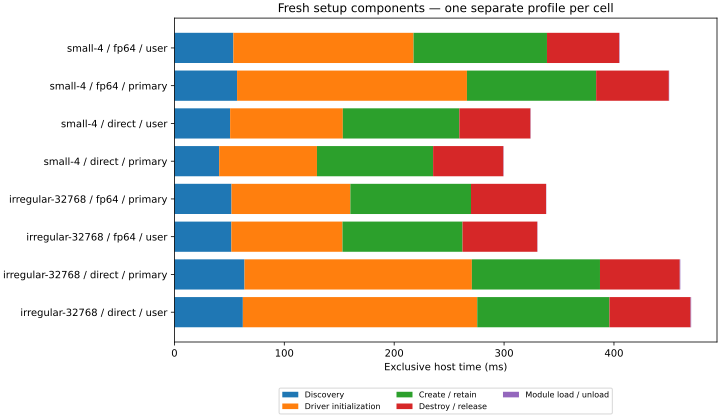

# Fresh LP setup diagnosis and experimental primary contexts

All **32 attempts independently verify**, all **24 fresh timings certify**, and
all **16 numerical/work comparisons match**. Primary contexts show **no consistent
fresh-process latency benefit**. The irregular-32768 direct-adaptive cell has a small
scoped regression; the other three paired intervals span one. The existing user
context remains the default; primary contexts remain an explicit study experiment.

This completes [SPEC-0018](../specifications/SPEC-0018-lp-fresh-setup.md) and
[ADR-0030](../decisions/ADR-0030-fresh-lp-setup.md). The result is a bounded negative
finding, not a supported preset or a claim about persistent/warm contexts.

## Evidence and frozen comparison

[Summary and paired intervals](data/setup/setup-summary.json),
[all attempts](data/setup/setup-trials.csv),
[profiles and work](data/setup/setup-profiles.json),
[component costs and profile overhead](data/setup/setup-components.json),
[pre-repair attribution](data/setup/setup-control-attribution.json),
[full compressed analysis](data/setup/setup-analysis.json.gz),
[source/ledger audit](data/setup/setup-source-ledger-audit.json),
[review corrections](data/setup/setup-review-corrections.json),
[resources](data/setup/setup-resources.json), and
[artifact catalog](data/setup/setup-provenance.json) retain the evidence.
The [protocol](../../benchmarks/configs/lp-setup-v1.json) is strict gpup-setup-v1.

The clean original baseline is `9bf8e8d5d6f6e4fd3b2eb60ae494506ed620323e`.
An instrumented user-context control was separately archived and its four profiles
completed before primary-context implementation. Its source archive contains no
primary implementation. A third archive holds the candidate. All binary/source hashes
are retained; both study executables independently verify every complete endpoint.
The clean original additionally supplies the twelve fixed-work acceptance controls.
Raw data remain in artifacts/gpup-setup-baseline, artifacts/gpup-setup-control,
artifacts/gpup-setup-v1 and artifacts/gpup-setup-acceptance.

Each context/method/model cell has three fresh timings and one separate profile:
user versus primary, tuned FP64 versus sticky direct accumulation-FP32-to-FP64,
and small-4 versus irregular-32768. Seed 17, one thread, affinity [0], final
1e-9 tolerances, 50000 physical updates, 30-second process limits, compact-v1,
and resident/necessary/warp32_v1/separate execution are unchanged. Direct audits
run every 32 updates at 1e-7 absolute/relative tolerances, without demotion.
Order seed 19001; 10000 paired bootstrap resamples with seed 19002 and 95% intervals.
Device: GPU-dfb2449a-9eff-e868-3597-2c448c9a8e48, RTX 5090.

Every primary attempt starts without a current or active primary context, sets
AUTO scheduling, retains once, makes current, checks UUID, drops children, detaches,
releases once and observes the primary context inactive afterward. Checked buffer,
stream and module cleanup is retained too. A separate setup receipt binds these
observations to the endpoint; numerical endpoint v1-v5 formats are unchanged.
The executed code hash is independently checked against the method's archived tuned
or precision image. The common archive provenance uses the precision image as its
reference image; it is not substituted for the per-endpoint execution identity.

## Certified fresh-process latency

The envelope includes process startup, input, discovery, driver/context/module setup,
iteration, original-model certification, teardown, endpoint and setup-receipt output.
Independent CPU verification is outside it. Ratios are medians of **paired ratios**,
not ratios of the displayed medians. A ratio above one favors primary contexts.

| Model / method | User median s | Primary median s | Paired user/primary [95% interval] | Certified |
| --- | ---: | ---: | ---: | ---: |
| small-4 / fp64 | 0.454874 | 0.417087 | 1.0906 [0.7107, 1.1615] | 3/3 + 3/3 |
| irregular-32768 / fp64 | 2.571193 | 2.699162 | 0.9526 [0.9452, 1.0249] | 3/3 + 3/3 |
| small-4 / direct | 0.360273 | 0.350029 | 0.9714 [0.8669, 1.0293] | 3/3 + 3/3 |
| irregular-32768 / direct | 3.974952 | 4.003252 | 0.9947 [0.9845, 0.9948] | 3/3 + 3/3 |

The direct irregular-32768 paired ratio is 0.9947 [0.9845, 0.9948], approximately
0.53% slower for primary contexts in this cell. Three development repetitions,
unadjusted intervals and one profile per cell do not support a general ranking.
No failure was omitted, retried or converted to a successful timing.

## Attribution and profile overhead

Before the repair, create/destroy takes 170.708–187.197 ms on small-4, or
42.86–48.00% of profiled process wall. Eliminating **all** of that cost would yield
an idealized 1.75–1.92x upper bound, assuming everything else stays fixed. The
corresponding bounds on irregular-32768 are only 1.05–1.07x. These are hypothetical
ceilings, not achieved speedups. Driver initialization and discovery remain separate.

The following disjoint exclusive costs are milliseconds from one profile per cell.
Create/retain and destroy/release are alternative lifecycle operations. A phase that
is not executed in one mode is not a measured zero-cost implementation of that phase.

| Model / method / context | Discovery | Driver init | Create / retain | Destroy / release | Module load / unload | RSS MiB | Profile / timing median |
| --- | ---: | ---: | ---: | ---: | ---: | ---: | ---: |
| small-4 / fp64 / user | 53.647 | 163.987 | 121.405 | 65.792 | 0.302 | 110.97 | 0.9603 |
| small-4 / fp64 / primary | 57.019 | 209.197 | 117.577 | 66.155 | 0.305 | 110.43 | 1.1562 |
| small-4 / direct / user | 50.715 | 102.558 | 106.042 | 64.666 | 0.228 | 110.81 | 0.9872 |
| small-4 / direct / primary | 40.736 | 88.994 | 105.696 | 63.926 | 0.231 | 111.08 | 0.9472 |
| irregular-32768 / fp64 / primary | 51.966 | 108.169 | 109.773 | 68.320 | 0.191 | 202.43 | 0.9522 |
| irregular-32768 / fp64 / user | 51.826 | 101.132 | 109.238 | 68.034 | 0.205 | 202.49 | 0.9986 |
| irregular-32768 / direct / primary | 63.784 | 206.917 | 116.575 | 72.607 | 0.506 | 229.98 | 1.0010 |
| irregular-32768 / direct / user | 62.286 | 213.309 | 120.306 | 73.834 | 0.523 | 230.07 | 1.0043 |



Primary retain/release still costs about 170–189 ms; it does not remove the underlying
fresh context work. Driver initialization varies from about 89 to 213 ms, discovery
from 41 to 64 ms, while the module load API is below 0.3 ms. The diagnosis therefore
does not support another module optimization within this slice. No driver-internal
cause is inferred from these host API timings.

Profiles are separate executions. Their process/primary-median ratios range from
0.9472 to 1.1562, mixing instrumentation overhead with run-to-run variation; they
are not overhead corrections for the primary samples. RSS is a 10 ms sampled
process-tree peak, not exact allocation accounting. Recorded device allocation requests
are identical between contexts: 680 bytes (small FP64), 712 bytes (small direct),
18079736 bytes (large FP64), and 33016480 bytes (large direct). These summed buffer
requests exclude driver/context allocations and are not a measured device-memory peak.
Complete inclusive/exclusive
scopes, remaining setup bookkeeping and process residuals are retained in the data;
parent times are never added to child times. No fresh trace or hardware counter
collection was needed, and no warm/session endpoint substitutes for these measurements.

## Acceptance, resources and handoff

Full pinned-native `bash tools/check.sh` passes 514 Rust tests and 195 Python
integration tests, exact-rational regressions, artifact checks, committed-record
replay, 110 documentation pages and smoke. An initial test-module ordering lint was corrected;
failed and passing CPU receipts are retained. The source-only budget/provenance tests
also pass from an isolated archive with no campaign artifacts.

The control passes 55 regular device tests; the candidate passes 58, including
three new primary-context cases. Memcheck, racecheck, initcheck and synccheck each
pass all three primary cases with no errors or race warnings. These receipts do not
close the historical tuned_cases racecheck gap. CPU fault injection covers missing
symbols, current/active refusal, partial initialization, UUID mismatch and cleanup
failures without double release. Device tests cover numerical agreement, child
resource ordering and retention of an actual isolated lock until final destruction.

All twelve 200-update original/primary pairs and twelve setup-bound replays match
numerical bits and physical work; both acceptance binaries verify all 36 endpoints.
Setup replay validates the source receipt/hash and restores its context policy.
All 32 study receipts record successful lifecycle and resource cleanup. No actual
GPU attempt failed or was retried. Kernels, original-model authority, numerical
settings and old schemas/protocols are preserved. The source audit checks 342
measured files and 190 historical authority files. A post-study self-review tightened
the CPU setup-source parser to require the nullable error field and enforce the
4096-event schema bound. Its regression covers a missing field, 4097 events and the
accepted 4096-event boundary. The runtime parser and a report-verifier correction are hash-bound in the
review-corrections record: 340 measured files and all 190 authority files remain
byte-identical. The report verifier now also requires each artifact reference to
use its attempt's canonical filename, preventing cross-attempt substitution even
when hashes match. Archived executables, timings and endpoint evidence are untouched;
these CPU validation corrections need no new device execution. The post-review full
pinned-native gate passes 514 Rust tests, 196 Python integration tests, record replay,
110 documentation pages and smoke; all 56 retained setup receipts still parse.

Task GPU charge: **224.608447458 seconds**: timing 47.100554150/900,
profiles 15.598178240/300, acceptance 161.909715068/600.
Combined cap 1800 seconds; additional allowance zero. Cumulative consumption:
**15632.281207415 / 18002.574545061 seconds**. All campaign and phase caps hold.
The **15606-event** ledger SHA-256 is
`ad3d84354f0b74ae62fcc019ee4dcbf29b0a3251d066f1e0f2df11ccb107230b`; the 15528-event prefix
`cb0dc57f9f92546f4cc2d93b0de3c8556d6b24517f71b7a6efaa91fa96afedb6`
and therefore all prior history remain intact. GPU jobs were serialized under the
shared lease and fully reserved before admission. Four build jobs and four CPU-hours
apply; metered child CPU totals 2085.569504 seconds. Small source-edit/catalog
actions are outside that meter; the retained CPU receipts are linked above.

The historical mixed-65536, large-session and tuned_cases racecheck limitations
remain open. No new allowance, supported preset or default change follows.
Handoff: optional GPUP-COPT-ADAPTER, then GPUP-CONVERGENCE before GPUP-7.

```sh
python3 tools/benchmark_lp_setup.py --dry-run
python3 tools/report_lp_setup.py
python3 tools/export_lp_setup.py
```

These reporting/export commands use retained archives and do not run device work.
The optional `--plot` export uses separately provisioned Matplotlib; it is not a
normal build/validation dependency. The completed frozen attempt identities cannot
be rerun. No external publication is part of this task.
